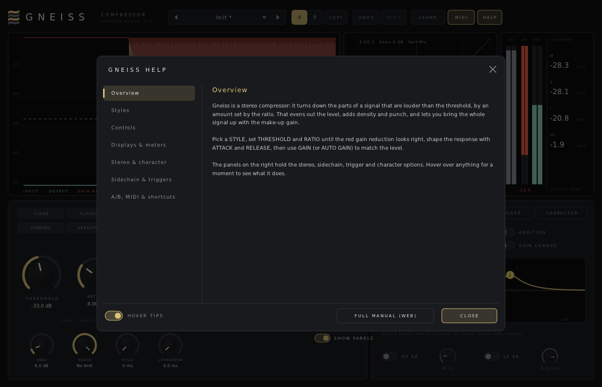

# Gneiss

**A stereo compressor plugin for macOS, Windows and Linux (VST3 · AU · CLAP · VST2).**

Part of **[Epsilon Audio](https://github.com/natehouk/epsilon-plugins)**, a family of free, open-source plugins: Monolith, Caldera, Obsidian, Strata, Basalt, Gneiss, Mica, Flint, Granite, Magma, Schist, Slate, Talc, Geode and Malachite.


Gneiss is a clean-room design with the feature set of FabFilter Pro-C, FabFilter's sixth plugin (August 2007), including the A/B comparison and undo/redo added in Pro-C 1.10. It was written from scratch, working only from FabFilter's public press releases. No FabFilter code, binaries, presets, artwork or trademarks were used.

It is part of a family of plugins: [Monolith](https://github.com/natehouk/monolith) (synth), [Caldera](https://github.com/natehouk/caldera) (filter), [Obsidian](https://github.com/natehouk/obsidian) (polysynth), [Strata](https://github.com/natehouk/strata) (tape delay), [Basalt](https://github.com/natehouk/basalt) (live dual filter) and **Gneiss**, which is named after a rock formed under pressure.

## Download

Get the latest build from [**Releases**](../../releases):

| Platform | File | Contains |
|---|---|---|
| macOS 10.13+ (Apple Silicon + Intel) | `Gneiss-macos-universal.zip` | VST3, AU, CLAP, manual |
| Windows x64 | `Gneiss-windows-x64.zip` | VST3, CLAP, VST2, manual |
| Linux x64 | `Gneiss-linux-x64.zip` | VST3, CLAP, VST2, manual |

### Install

| Platform | Copy | To |
|---|---|---|
| macOS | `Gneiss.vst3` / `Gneiss.component` / `Gneiss.clap` | `~/Library/Audio/Plug-Ins/VST3` / `Components` / `CLAP` |
| Windows | `Gneiss.vst3` (folder) / `Gneiss.clap` | `C:\Program Files\Common Files\VST3\` / `CLAP\` |
| Linux | `Gneiss.vst3` / `Gneiss.clap` | `~/.vst3/` / `~/.clap/` |

**macOS:** the plugins are ad-hoc signed, not notarized. After copying, run:

```
xattr -dr com.apple.quarantine ~/Library/Audio/Plug-Ins/*/Gneiss*
```

## Features

**Compression**
- **Three styles:**

  | Style | Design | Character |
  |---|---|---|
  | **Clean** | Feed-forward peak detection | Precise and transparent; attack down to 0.01 ms |
  | **Classic** | Feedback (the detector hears the compressed signal); release lengthens after sustained compression | Smooth, musical "glue" |
  | **Opto** | RMS detection, wide knee, release slows the harder it works | Slow, gentle levelling |

- **Controls:**
  - Threshold: −60 to 0 dB
  - Ratio: 1:1 to 20:1
  - Knee: 0 to 24 dB
  - Attack: 0.01 to 250 ms
  - Release: 5 ms to 2.5 s
  - Make-up gain: −12 to +36 dB
- **Auto gain**: compensates the level automatically from the threshold and ratio.
- **Mix**: parallel ("New York") compression.
- **Zero latency**: there's no lookahead.
- **Click-free automation**: every control is smoothed.

**Stereo and sidechain** (in the **Expert** panel)
- **Left/right** or **mid/side** processing.
- **Stereo link**, from fully independent to fully linked.
- **External sidechain input** (stereo) for ducking.
- **48 dB/oct high- and low-pass filters** on the detector, so the kick doesn't pump the mix, or for de-essing.
- **Listen**: hear the detector signal while you set the sidechain filters.

**Displays**
- **Level display.** About ten seconds of input, output and gain reduction. The threshold line can be dragged.
- **Transfer curve.** Shows a live dot at the current input level. Drag it to set the threshold.
- **Meters**: input, gain reduction (per channel, or mid/side) and output.

**Workflow**
- **A/B comparison**: two complete settings, with copy between them.
- **Undo/redo** for every edit, preset load and A/B switch.
- **MIDI Learn**, saved with your project.
- **Big knobs** with vertical and circular dragging. Double-click to type a value; Cmd/Ctrl-click to reset.
- **31 factory presets** in five categories (Vocals, Drums, Bass & Keys, Bus & Master, Creative), plus your own user presets.
- **Hover tips** on every control, display and button.
- **HELP window** with seven pages.
- **[Full manual](docs/MANUAL.md)**, also in every release zip as `Gneiss-Manual.html`.
- **Resizable** window.



### Compared with FabFilter Pro-C (2007, 1.10)

| Pro-C | Gneiss |
|---|---|
| Clean, Classic and Opto styles, each with its own algorithm, knee and topology (feedback or feed-forward) | ✓ |
| Program-dependent attack and release, very fast attack | ✓ (program-dependent release in Classic and Opto) |
| Zero-latency 64-bit processing | Zero latency; 32-bit float processing |
| Left/right or mid/side, customisable channel linking | ✓ |
| External sidechain, 48 dB/oct sidechain low- and high-pass filters | ✓ plus Listen |
| Expert mode for the advanced sidechain options | ✓ |
| Animated level display, active transfer curve, input/output/gain meters | ✓ |
| Large knobs with vertical and circular drag modes | ✓ |
| Interactive MIDI Learn, smoothed parameters, sample-accurate automation | ✓ |
| Help file with interactive hints | ✓ hover tips, in-plugin help pages and full manual |
| Undo/redo and A/B comparison (1.10) | ✓ |
| Stereo and mono versions | Stereo (use it on mono tracks as normal) |
| — | Extras: auto gain, mix, sidechain listen, user presets |
| Pro Tools (RTAS/AAX) | Not supported (needs Avid's SDK and signing) |

## Build from source

The plugin is built on [DPF](https://github.com/DISTRHO/DPF):

```
git clone --recursive https://github.com/DISTRHO/DPF.git dpf
make -C plugins/Gneiss                    # Linux / macOS (macOS also builds the AU)
make -C plugins/Gneiss WINDOWS=true CC=x86_64-w64-mingw32-gcc CXX=x86_64-w64-mingw32-g++
```

GitHub Actions builds all three platforms on every push. The macOS build is universal and ad-hoc signed. A `v*` tag, or a release published on GitHub, attaches the zips to that release.

## Tests

```
cd tests
g++ -O2 -std=c++11 features.cpp -o features && ./features   # static curve per style, knee, attack/release timing, program-dependent release,
                                                            # link, mid/side, external sidechain, sidechain filters + listen, mix, gain, meters
g++ -O2 -std=c++11 fuzz.cpp -o fuzz && ./fuzz               # random parameters at 44.1-192 kHz, with/without sidechain: always finite
g++ -O2 -std=c++11 presets.cpp -o presets && ./presets      # plays a drum loop through every preset (kick on the sidechain)
g++ -O3 -std=c++11 bench.cpp -o bench && ./bench            # CPU: under 1% of one core in the heaviest configuration
```

Release checks:
- Steinberg's VST3 validator passes 47/47, including the sidechain bus.
- The interface is exercised with scripted input and live audio (Expert, threshold dragging, A/B, tips, help).

## Source layout

| File | Contents |
|---|---|
| `plugins/Gneiss/GneissEngine.hpp` | All DSP. Header-only |
| `plugins/Gneiss/ParamDefs.hpp` | Parameter table, labels, value mapping |
| `plugins/Gneiss/Presets.hpp` | Factory presets |
| `plugins/Gneiss/UserPresets.hpp` | User preset files |
| `plugins/Gneiss/Help.hpp` | Hover tip text and in-plugin help pages |
| `plugins/Gneiss/GneissPlugin.cpp` | Plugin wrapper: parameters, sidechain ports, programs, MIDI Learn, meters |
| `plugins/Gneiss/GneissUI.cpp` | Custom vector interface (NanoVG) |
| `docs/MANUAL.md` | User manual (`Gneiss-Manual.html` is generated from it with pandoc) |

New parameters are only ever appended, so saved sessions and automation keep working across versions.

## License

[MIT](LICENSE). Built with [DPF](https://github.com/DISTRHO/DPF) and its bundled NanoVG, which are under the ISC license. `plugins/Gneiss/ResizeHandle.hpp` comes from DPF's examples and keeps its ISC notice.

"FabFilter" and "FabFilter Pro-C" are trademarks of FabFilter Software Instruments. Gneiss is not affiliated with or endorsed by FabFilter.
