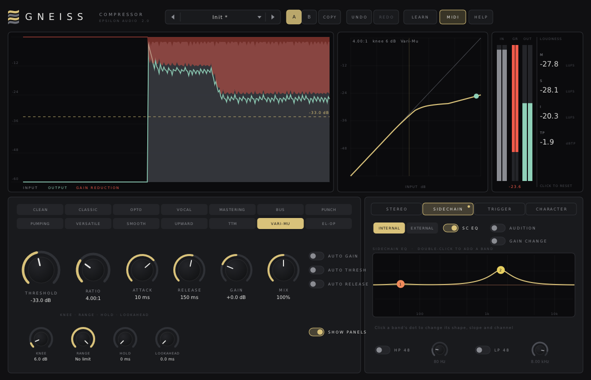

# Gneiss 2.1 — User Manual

Gneiss is a stereo compressor. It has:

- **Fourteen styles**, including upward compression, a combined up-and-down style (TTM) and vari-mu.
- **Dynamics controls**: knee up to 72 dB, hold, range, a gain-change mix from 0 to 200%, and lookahead up to 20 ms.
- **Automatic help**: auto threshold, auto release and auto gain.
- **Oversampling** up to 32x.
- **Analog character**: warm, punchy or vintage, before or after the compressor.
- **Six stereo modes**, including mid-to-side and side-to-mid.
- **An external sidechain** with a 6-band sidechain EQ.
- **Triggering** from MIDI notes or tempo-synced pulses.
- **Audition** of the trigger and of the gain change.
- **EBU R128 loudness metering**.

Gneiss runs as VST3, AU, CLAP and VST2 on macOS, Windows and Linux.

**Contents**

1. [Installing](#1-installing)
2. [A quick tour](#2-a-quick-tour)
3. [Compression in two minutes](#3-compression-in-two-minutes)
4. [The styles](#4-the-styles)
5. [The main controls](#5-the-main-controls)
6. [The displays and meters](#6-the-displays-and-meters)
7. [The STEREO panel](#7-the-stereo-panel)
8. [The SIDECHAIN panel](#8-the-sidechain-panel)
9. [The TRIGGER panel](#9-the-trigger-panel)
10. [The CHARACTER panel](#10-the-character-panel)
11. [Using an external sidechain in your DAW](#11-using-an-external-sidechain-in-your-daw)
12. [Latency](#12-latency)
13. [A/B, undo and redo](#13-ab-undo-and-redo)
14. [MIDI Learn](#14-midi-learn)
15. [Presets](#15-presets)
16. [Help and hover tips](#16-help-and-hover-tips)
17. [Recipes](#17-recipes)
18. [Keyboard and mouse reference](#18-keyboard-and-mouse-reference)
19. [Parameter reference](#19-parameter-reference)
20. [Compatibility with Gneiss 1.x](#20-compatibility-with-gneiss-1x)
21. [Troubleshooting](#21-troubleshooting)

---

## 1. Installing

Download the zip for your system from the project's **Releases** page and copy the plugin files:

| System | Copy | To |
|---|---|---|
| macOS | `Gneiss.vst3`, `Gneiss.component` (AU), `Gneiss.clap` | `~/Library/Audio/Plug-Ins/VST3`, `.../Components`, `.../CLAP` |
| Windows | the `Gneiss.vst3` folder, `Gneiss.clap` | `C:\Program Files\Common Files\VST3\`, `...\CLAP\` |
| Linux | `Gneiss.vst3`, `Gneiss.clap` | `~/.vst3/`, `~/.clap/` |

**macOS:** if a build is not notarized and macOS blocks it, open Terminal and run:

```
xattr -dr com.apple.quarantine ~/Library/Audio/Plug-Ins/*/Gneiss*
```

Then rescan plugins in your DAW. Gneiss appears under **Epsilon Audio** as a dynamics plugin. Gneiss 2.0 replaces 1.x in place: your sessions and presets keep working and sound the same (see [section 20](#20-compatibility-with-gneiss-1x)).

---

## 2. A quick tour



- **Header**: the preset browser, **A / B / COPY**, **UNDO / REDO**, **LEARN**, **MIDI** and **HELP**. The right edge shows the latency when lookahead or oversampling adds any.
- **Level display** (left): the last few seconds of input level, output level and gain reduction. Upward boost shows in green, and trigger activity shows along the bottom. The threshold is the dashed line.
- **Transfer curve** (centre): how input level maps to output level.
- **Meters** (right): input, gain change and output, plus output **loudness** (momentary, short-term, integrated, true peak).
- **Main panel** (bottom left):
  - the fourteen styles
  - THRESHOLD, RATIO, ATTACK, RELEASE, GAIN and MIX
  - AUTO GAIN, AUTO THRESH and AUTO RELEASE
  - KNEE, RANGE, HOLD and LOOKAHEAD
- **Panels** (bottom right): switch on **SHOW PANELS**, then pick **STEREO**, **SIDECHAIN**, **TRIGGER** or **CHARACTER**. A gold dot on a tab means something on it is active.

Hover over anything for a moment and a tip explains it.

---

## 3. Compression in two minutes

A compressor turns down whatever is louder than the **threshold**, and the **ratio** says by how much. At 4:1, a signal that goes 8 dB over the threshold comes out only 2 dB over it: 6 dB of **gain reduction**. **Attack** and **release** set how quickly that reduction starts and stops. The loud parts are now quieter, so you can raise everything with **make-up gain**. The result is more even, denser and often louder.

A good starting routine:

1. Pick a **style**.
2. Lower the **threshold** until the red gain reduction moves by a few dB on the loudest parts.
3. Adjust **ratio**: higher for firmer control.
4. Shape the feel with **attack** and **release**:
   - longer attack lets transients through for more punch
   - shorter release sounds livelier, longer release smoother
5. Raise **gain** (or turn on **auto gain**) until the level matches the bypassed sound.
6. Compare with **A/B**.

---

## 4. The styles

| Style | Character | Good for |
|---|---|---|
| **Clean** | Feed-forward, follows peaks, very fast attack available | Transparent control, peak taming |
| **Classic** | Feedback design: eases into compression, release lengthens after sustained compression | Drums, buses |
| **Opto** | Averaged detection, wide soft knee, release slows the harder it works | Vocals, bass |
| **Vocal** | Gentle on quiet words, firmer on loud ones, wide knee | Lead and spoken vocals |
| **Mastering** | Slow averaged detection, soft knee, longer times | Whole mixes |
| **Bus** | Feedback design with an adaptive release | Groups, mix bus glue |
| **Punch** | Lets the start of each hit through before clamping down | Drums, percussion |
| **Pumping** | Releases at a steady rate, so the level swells back audibly | Pumping and breathing effects |
| **Versatile** | A balanced all-rounder between Clean and Classic | A good first choice |
| **Smooth** | Averaged detection, soft knee, gentle timing | Transparent levelling |
| **Upward** | Brings quiet parts up toward the threshold; loud parts untouched | Detail, room sound, sustain |
| **TTM** (To The Max) | Compresses loud parts down and brings quiet parts up, fast | Dense, in-your-face sounds |
| **Vari-Mu** | The ratio grows with level: barely compressing just over the threshold, firm on peaks | Warm, gentle bus and bass compression |
| **El-Op** | Electro-optical: very soft knee, two-stage release that slows after sustained compression | Smooth, natural vocals and instruments |

**Upward** boosts by up to the RANGE setting. With RANGE at its maximum, the boost stops at 24 dB. Signals more than 40 dB under the threshold are left alone, so noise floors don't come up.

---

## 5. The main controls

| Control | What it does |
|---|---|
| **Threshold** | Where compression starts (−60 to 0 dB). You can also drag in the level display or the transfer curve. |
| **Ratio** | 1:1 (no compression) to 100:1. All the way up is **Inf:1**: a hard limit at the threshold. |
| **Attack** | 0.01 to 250 ms. |
| **Release** | 5 ms to 2.5 s. Several styles also adapt it to the material. |
| **Gain** | Make-up gain, −12 to +36 dB. |
| **Mix** | Scales the **gain change** from 0% (none) to 200% (double). Everything stays in phase, so it works like parallel compression at any setting below 100%, and exaggerates above it. |
| **Auto Gain** | Adds make-up gain from the threshold and ratio, so the level doesn't jump as you change them. |
| **Auto Thresh** | Makes the threshold relative to the material's level, measured over about a second. The compressor then does the same amount of work whether the input is loud or quiet. Set the threshold for a typical level of −18 dBFS. Ideal for dialogue and sources that change level. |
| **Auto Release** | Adapts the release: faster after short peaks, slower during sustained compression. RELEASE sets the overall speed. |
| **Knee** | 0 (hard) to 72 dB. Very wide knees with a fast attack start to saturate. |
| **Range** | The most the gain may change, in dB. 60 dB means no limit. |
| **Hold** | Keeps the gain reduction for up to 500 ms before the release starts. Stops fast releases from fluttering on low notes. |
| **Lookahead** | Lets the compressor see up to 20 ms ahead, so it is already working when a peak arrives. Adds latency (see [section 12](#12-latency)). |

---

## 6. The displays and meters

- **Level display**: shows the last few seconds.
  - Input level in grey, output level in colour.
  - Gain reduction in red, hanging from the top; upward boost in green.
  - Gold marks along the bottom while a MIDI note or a tempo pulse is triggering.
  - Drag up and down to move the threshold. With AUTO THRESH on, the label says "(auto)".
- **Transfer curve**: input level (horizontal) against output level (vertical), before make-up gain, for the current style, knee, range and mix. The dot is the current input level. Drag left and right to move the threshold.
- **Meters**: input peaks, gain change and output peaks. The gain change is red when reducing and green when boosting.
- **Loudness** (EBU R128 / ITU-R BS.1770), measured at the output. Click the readout to reset I and TP.
  - **M**: momentary loudness (400 ms).
  - **S**: short-term loudness (3 s).
  - **I**: integrated loudness since the last reset, gated as the standard describes.
  - **TP**: the highest true peak since the last reset, 4x oversampled.

---

## 7. The STEREO panel

- **CHANNELS**:

  | Mode | What happens |
  |---|---|
  | **L / R** | Left and right are compressed (linked by LINK). |
  | **M / S** | Mid (centre) and side (stereo) are compressed instead. |
  | **MID** | Only the mid is compressed; the side passes untouched. |
  | **SIDE** | Only the side is compressed. |
  | **MID > SIDE** | The mid's level compresses the side. For example, the stereo bed ducks when the centre (a vocal) is loud. |
  | **SIDE > MID** | The side's level compresses the mid. |

- **LINK**: how much the two channels share one gain reduction. It applies to L/R and M/S.
- **OVERSAMPLING**: OFF, 2x, 4x, 8x, 16x or 32x. Runs the gain stage and the character stage at that multiple of the sample rate, using linear-phase filters. Use it with fast attacks, heavy character or limiting, to avoid aliasing. It costs latency and CPU; 32x is the heaviest setting.
- **DRY/WET**: blends the dry signal back in, for classic parallel compression. It is the 1.x Mix control.

---

## 8. The SIDECHAIN panel

The sidechain is what the compressor *listens to*. You never hear it, unless you audition it.

- **INTERNAL / EXTERNAL**: listen to the input, or to the sidechain input (see [section 11](#11-using-an-external-sidechain-in-your-daw)).
- **SC EQ**: switches the sidechain EQ on or off.
- **SIDECHAIN EQ display**: up to **6 bands** with all of Mica's shapes:
  - bell, shelves, cuts, notch, band pass, tilt shelf, flat tilt, all pass
  - slopes up to 96 dB/oct, and brickwall cuts

  Editing bands:
  - Double-click to add a band.
  - Drag a dot to set its frequency and gain (or its Q, for shapes without gain). The mouse wheel changes Q.
  - Alt-click switches a band off; right-click (or Delete) removes it.

  Click a dot to select it. The selected band's **shape**, **slope** and **channel** steppers sit below the display. The channel can be the whole sidechain (STEREO), or only its mid or side. The gold line shows the total sidechain response, including the 48 dB filters.
- **HP 48 / LP 48**: the 1.x 48 dB/oct sidechain high pass and low pass, with their frequencies.
- **AUDITION**: hear what the compressor listens to, after the sidechain EQ and filters, instead of the output.
- **GAIN CHANGE**: hear only what the compressor takes away. A quick way to hear where and how much it works.

When either audition is on, the status line in the level display turns red.

---

## 9. The TRIGGER panel

Triggers drive the compressor without any audio. They add to the audio trigger: whichever is louder wins.

- **MIDI NOTES**: while a MIDI note is held, the compressor acts as if the key were at the note's velocity (127 = 0 dBFS). Route a MIDI track to Gneiss in your DAW.
- **TEMPO PULSE**: a pulse in time with your song, which you can use for classic sidechain pumping without a kick track.
  - **SYNC** sets how often it repeats: 1/1 to 1/32, dotted and triplet values.
  - **OFFSET** moves the pulse later within each period, for example 50% for off-beats.
  - **LENGTH** sets how long it lasts.

  The pulse follows your host's tempo and position. When the transport is stopped, it free-runs at the host tempo.

The **TRIGGER** lamp, and the gold marks in the level display, light while a trigger is active.

---

## 10. The CHARACTER panel

- **CHARACTER**:
  - **OFF**: perfectly clean.
  - **WARM**: tube-like saturation with mostly even harmonics.
  - **PUNCHY**: rounds off peaks with odd harmonics.
  - **VINTAGE**: warm saturation, a little low-end weight, a softened top, and slow analog drift. The colour and threshold wander very slightly.
- **DRIVE**: how hard the stage is pushed. Small signals keep their level, so drive changes the colour, not the loudness.
- **POSITION**:
  - **POST** colours the compressed signal.
  - **PRE** colours the input, and the compressor then tames the extra harmonics.

The character stage runs inside the oversampling, so use oversampling for heavy drive.

---

## 11. Using an external sidechain in your DAW

Gneiss has a stereo sidechain input in VST3, AU and CLAP. To use it:

1. Put Gneiss on the track you want to duck or control (for example a bass or pad).
2. In Gneiss, switch on **SHOW PANELS**, open **SIDECHAIN** and select **EXTERNAL**.
3. Route the trigger (for example a kick drum) to Gneiss's sidechain:
   - **Ableton Live**: in Gneiss's device, open the sidechain section, or choose the kick track as Audio From in the plugin's input chooser.
   - **Logic Pro**: choose the trigger track in the plugin window's **Side Chain** menu.
   - **Bitwig**: use the plugin's sidechain input selector.
   - **Reaper**: send the trigger track to channels 3/4 of the Gneiss track and enable them as the plugin's sidechain pins.
   - **Cubase / Studio One**: activate the plugin's sidechain and add a send from the trigger track to it.
4. Lower the threshold until the bass ducks on each kick, and set the release to taste (100–300 ms for classic pumping).

The sidechain EQ works on the external signal too.

---

## 12. Latency

Gneiss adds no latency unless you use lookahead or oversampling:

| Source | Latency |
|---|---|
| Lookahead | as set (up to 20 ms) |
| Oversampling 2x / 4x / 8x / 16x / 32x | 32 / 48 / 56 / 60 / 62 samples |

The header shows the total, and Gneiss reports it to your host, which compensates automatically. When you change lookahead or oversampling while playing, some hosts only apply the new latency after playback stops.

---

## 13. A/B, undo and redo

**A/B**: Gneiss holds two complete settings.
- Click **B** to switch to it; the first time, B starts as a copy of A.
- Click **A** to go back.
- **COPY** copies the current slot into the other one.

**Undo / redo**: every edit made in Gneiss's window counts as one step. That includes knobs, buttons, styles, sidechain EQ bands, preset loads and A/B switches. Use the header buttons, or **Cmd/Ctrl-Z** and **Cmd/Ctrl-Shift-Z** (or **Cmd/Ctrl-Y**).

---

## 14. MIDI Learn

1. Route a MIDI track or controller to Gneiss in your DAW.
2. Click **LEARN**.
3. Click a control.
4. Move a knob or fader on your controller. The control shows its **CC** number.
5. Click **LEARN** again, or press Esc.

To remove assignments, right-click a control in Learn mode, or use **CLEAR ALL ASSIGNMENTS**. Assignments are saved with your project.

The **MIDI** button in the header switches MIDI control and MIDI triggering on or off together.

---

## 15. Presets

| Category | Inside |
|---|---|
| **Vocals** | Gentle, present, leveller, aggressive, sibilance tamer, rap; Vocal Rider, El-Op Vocal, De-Ess (SC EQ) |
| **Drums** | Kick punch, snare snap, drum bus, smash, parallel drums, room pump; Punch Drums, To The Max, Upward Detail |
| **Bass & Keys** | Even and tight bass, synth bass, smooth piano, guitar sustain, acoustic; Vari-Mu Bass, Smooth Keys |
| **Bus & Master** | Glue, gentle mix bus, master leveller, wide bus, mid/side control, low-end glue; Bus Glue 2, Mastering Glue, Peak Limiter, Tape Bus |
| **Creative** | Sidechain duck, kick pump, New York, squash, sustainer, lo-fi crush; Dialog Leveler, Tempo Pump, MIDI Pump |

- The 2.0 presets come after the 1.x ones, so 1.x program numbers stay the same.
- A **\*** after the preset name means you have changed it.
- **SAVE CURRENT AS...** stores your own preset.
- To delete a user preset, right-click it, then click it again.

| System | User preset folder |
|---|---|
| macOS | `~/Library/Audio/Presets/Epsilon Audio/Gneiss/` |
| Windows | `%APPDATA%\Epsilon Audio\Gneiss\Presets\` |
| Linux | `~/.config/epsilon-audio/gneiss/presets/` |

**Search and favourites.** With the browser open, just type to narrow the list to presets whose name or category matches; Backspace edits, Esc clears the search and then closes the browser. Click the star at the right of a preset to add it to the FAVOURITES column, and again to remove it. Favourites are kept in `favourites.txt` in your presets folder.

---

## 16. Help and hover tips

- **Hover tips**: rest the pointer on anything for a moment and a tip explains it, with its current value and any MIDI CC assigned to it. Each style has its own tip.
- **HELP** opens short help pages. The **HOVER TIPS** switch turns tips on or off, and **FULL MANUAL (WEB)** opens this manual.

---

## 17. Recipes

**Vocal leveller.** Vocal or Opto style, ratio 3:1, attack 10–20 ms, release 200–400 ms with AUTO RELEASE. Aim for 3–6 dB of reduction on loud phrases.

**Dialogue that changes level.** Versatile, ratio 3:1, AUTO THRESH and AUTO RELEASE on, threshold −24 dB. The amount of compression stays steady as the speaker moves closer or further away.

**Punchy drums.** Punch style, ratio 4:1, attack 10–20 ms, release 60–100 ms, 4–8 dB of reduction.

**Mix bus glue.** Bus style, ratio 2:1, attack 30 ms, release 150–250 ms. Add a low cut at 90 Hz in the sidechain EQ, and aim for 1–3 dB of reduction.

**Peak limiter.** Clean, ratio Inf:1, attack 0.05 ms, LOOKAHEAD 5 ms, HOLD 5 ms, oversampling 8x.

**Parallel compression.** Any style, heavy settings, then **MIX** at 30–50%. The gain change is scaled, and everything stays in phase.

**Sidechain ducking.** Clean, ratio 6:1, attack 1 ms, release 150–250 ms, EXTERNAL, kick routed to the sidechain ([section 11](#11-using-an-external-sidechain-in-your-daw)).

**Tempo pumping with no kick.** Pumping style, TEMPO PULSE on, SYNC 1/4, LENGTH 20%, threshold −12 dB, ratio 6:1.

**De-esser.** Clean, ratio 6:1, attack 0.5 ms, release 40 ms.
1. In the sidechain EQ, add a low cut at 4 kHz and a bell boost around the harshest frequency (5–8 kHz).
2. Use AUDITION to find it.
3. Lower the threshold until only the "s" sounds trigger it.

**Upward compression for detail.** Upward style, ratio 2:1, threshold a little under the average level, RANGE 6–9 dB. Quiet details and room tone come up.

**Warm bus.** Vari-Mu or Bus style with WARM or VINTAGE character at 30–50% drive, oversampling 4x.

---

## 18. Keyboard and mouse reference

| Action | Result |
|---|---|
| Drag a knob's middle | Adjust (Shift = fine) |
| Grab a large knob's rim | Turn in a circle |
| Double-click a knob | Type a value (`-24`, `4`, `inf`, `150`, `1.5s`) |
| Cmd/Ctrl-click a knob | Reset |
| Mouse wheel over a knob | Small steps (Shift = finer) |
| Drag in the level display / transfer curve | Threshold |
| Double-click the sidechain EQ | Add a band |
| Drag a sidechain EQ dot | Frequency and gain (Shift = fine) |
| Mouse wheel over a sidechain EQ dot | Q |
| Alt-click / right-click a sidechain EQ dot | Switch off / remove |
| Click the loudness readout | Reset integrated loudness and true peak |
| Cmd/Ctrl-Z | Undo |
| Cmd/Ctrl-Shift-Z, Cmd/Ctrl-Y | Redo |
| Mouse wheel on preset name | Previous / next preset |
| Esc | Leave Learn mode, close Help, cancel typing |

---

## 19. Parameter reference

| Parameter | Range | Default |
|---|---|---|
| Style | Clean, Classic, Opto, Vocal, Mastering, Bus, Punch, Pumping, Versatile, Smooth, Upward, TTM, Vari-Mu, El-Op | Clean |
| Threshold | −60 – 0 dB | −18 dB |
| Ratio | 1:1 – 100:1 (top = Inf:1) | 4:1 |
| Knee | 0 – 72 dB | 6 dB |
| Attack | 0.01 – 250 ms | 10 ms |
| Release | 5 – 2500 ms | 150 ms |
| Gain | −12 – +36 dB | 0 dB |
| Auto Gain | Off, On | Off |
| Mix (dry/wet) | 0 – 100 % | 100 % |
| Channel Mode | Left/Right, Mid/Side, Mid Only, Side Only, Mid to Side, Side to Mid | Left/Right |
| Stereo Link | 0 – 100 % | 100 % |
| Sidechain | Internal, External | Internal |
| Sidechain High Pass / Low Pass | Off, On; 20 Hz – 20 kHz | Off; 80 Hz / 8 kHz |
| Sidechain Listen (audition trigger) | Off, On | Off |
| Hold | 0 – 500 ms | 0 ms |
| Range | 0 – 60 dB (60 = no limit) | 60 dB |
| Gain Change Mix | 0 – 200 % | 100 % |
| Lookahead | 0 – 20 ms | 0 ms |
| Oversampling | Off, 2x, 4x, 8x, 16x, 32x | Off |
| Auto Threshold, Auto Release | Off, On | Off |
| Character | Off, Warm, Punchy, Vintage | Off |
| Drive | 0 – 100 % | 30 % |
| Character Position | Post, Pre | Post |
| MIDI Trigger, Pulse Trigger | Off, On | Off |
| Pulse Sync | 1/1, 1/2, 1/4, 1/8, 1/16, 1/32, 1/4 and 1/8 dotted, 1/4 and 1/8 triplet | 1/4 |
| Pulse Offset / Length | 0 – 100 % | 0 % / 25 % |
| Audition Gain Change | Off, On | Off |
| Sidechain EQ | Off, On | On (no bands) |
| SC EQ n Used / Enabled / Shape / Frequency / Gain / Q / Slope / Channel | as Mica's bands; channel Stereo, Mid, Side | — |
| MIDI | Off, On | On |

The meters (input, output, gain change, loudness, trigger) are output parameters, so hosts can display them.

---

## 20. Compatibility with Gneiss 1.x

Gneiss 2.0 is the same plugin (same IDs), version 2.0.

- **Sessions load and sound the same.** Every 1.x parameter keeps its number and meaning. The 2.0 parameters come after them, with defaults that change nothing: no hold, range at no limit, 100% gain-change mix, no lookahead, no oversampling, character off. An automated test plays random 1.x settings through a frozen copy of the 1.0.1 engine and through 2.0. The outputs are identical.
- **Ranges that grew:**
  - Ratio now goes to 100:1 (Inf:1) instead of 20:1.
  - Knee goes to 72 dB instead of 24.
  - Channel mode has four more modes.

  Stored values keep their meaning. Hosts that store automation as a 0–1 position along a control's range may map existing automation lanes for these three controls differently, so check them after upgrading.
- **Factory presets** keep their program numbers; the fifteen 2.0 presets come after them.
- **User presets** and **MIDI Learn** assignments carry over.
- **The EXPERT switch** is now **SHOW PANELS**.
- **The window** is larger by default (1180 × 760) and still resizes freely.

---

## 21. Troubleshooting

**Nothing happens with External sidechain.** The sidechain input is empty. Route a trigger to it ([section 11](#11-using-an-external-sidechain-in-your-daw)), or switch back to Internal.

**I hear a thin, filtered sound, or only clicks and breaths.** An audition is on: AUDITION (what the compressor hears) or GAIN CHANGE (what it removes). The status line turns red when one is on. Switch it off in the SIDECHAIN panel.

**The tempo pulse doesn't line up with the beat.** Use OFFSET to move it. Some hosts only report their position while playing; when stopped, the pulse free-runs.

**My DAW shows extra delay.** Lookahead and oversampling add latency ([section 12](#12-latency)), which hosts compensate. For live monitoring, set both to zero.

**High CPU.** Oversampling at 16x or 32x with character is the heaviest combination. 4x is usually enough.

**Cmd/Ctrl-Z undoes something in my DAW.** The host keeps the shortcut; use the UNDO / REDO buttons.

**The plugin doesn't appear.** Check the install folders and rescan. On macOS, run the `xattr` command from section 1. Logic needs the `.component` file.

---

Gneiss is free software under the MIT license.
